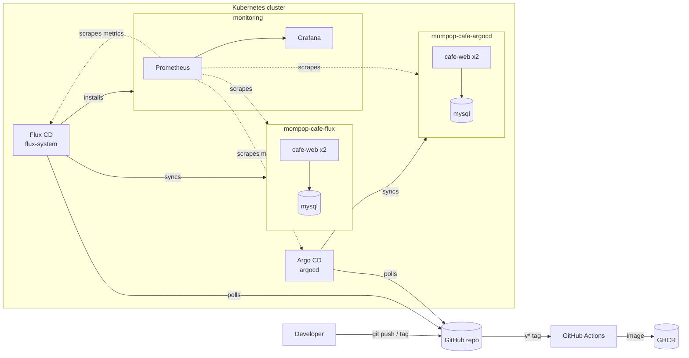

# GitOps on Kubernetes: Flux CD vs Argo CD, monitored with Prometheus & Grafana

[](https://github.com/praneshragavendar/gitops-flux-vs-argocd/actions/workflows/e2e-kind.yaml)

Three apps (a **static site** on nginx, a **PHP + MySQL** web app, and a **Java** WAR on Tomcat) are each deployed to one Kubernetes cluster **twice**, once by **Flux CD** and once by **Argo CD**, each copy in its own namespace. **Prometheus and Grafana** watch both tools so you can compare how fast they sync, how much CPU and memory they use, and how they handle errors and drift.

Git is the single source of truth. No one runs `kubectl apply` for the app: a change goes in through a commit, and the GitOps tools roll it out.

**Verified end to end in CI:** every change runs the whole setup on a throwaway 3-node Kubernetes cluster (kind: 1 control plane + 2 workers) in GitHub Actions: both tools deploy all three apps, Prometheus and Grafana come up, both copies are smoke-tested, a drift test runs, and real metrics are pulled from Prometheus into the job summary. See [Verified in CI](#verified-in-ci).

## Architecture



## Tech stack

| Area | Tools |
|---|---|
| Orchestration | Kubernetes (kind / minikube / k3s) |
| GitOps | Flux CD v2, Argo CD |
| Config management | Kustomize (base + overlays), Helm (via Flux HelmRelease) |
| Monitoring | kube-prometheus-stack: Prometheus, Grafana, kube-state-metrics, node-exporter |
| CI | GitHub Actions → GitHub Container Registry (GHCR) |
| App | PHP 7.4 + Apache, MySQL 8.0 |

## Repository layout

```
.
├── app/
│   ├── web/                          # PHP app source + Dockerfile (dynamic, uses MySQL)
│   ├── static/                       # static site + nginx Dockerfile
│   └── java/                         # Maven WAR + multi-stage Dockerfile (Tomcat)
├── apps/
│   ├── mompop-cafe/                  # PHP + MySQL: Deployments, Services, PVC, ConfigMap, DB seed script
│   │   ├── base/
│   │   └── overlays/flux | argocd    # → mompop-cafe-flux :30080 / mompop-cafe-argocd :30081
│   ├── cafe-static/                  # static site
│   │   ├── base/
│   │   └── overlays/flux | argocd    # → cafe-static-flux :30090 / cafe-static-argocd :30091
│   └── java-app/                     # Java WAR on Tomcat
│       ├── base/
│       └── overlays/flux | argocd    # → java-app-flux :30092 / java-app-argocd :30093
├── argocd/                           # one Argo CD Application per app → apps/<app>/overlays/argocd
├── clusters/my-cluster/              # everything Flux syncs
│   ├── flux-system/                  # created by `flux bootstrap`
│   ├── mompop-cafe.yaml, cafe-static.yaml, java-app.yaml   # Flux Kustomizations → apps/<app>/overlays/flux
│   └── infrastructure.yaml           # Flux Kustomizations → monitoring stack + config
├── infrastructure/monitoring/
│   ├── stack/                        # HelmRelease for kube-prometheus-stack
│   └── config/                       # PodMonitor (Flux), ServiceMonitors (Argo CD), Grafana dashboard
├── ci/
│   ├── kind-config.yaml              # 3-node kind cluster for the CI test (maps the six NodePorts)
│   ├── e2e.sh                        # deploy with both tools, smoke test, drift test, collect metrics
│   └── prom_query.py                 # queries Prometheus and writes the metrics table
└── .github/workflows/
    ├── build-image.yaml              # builds the three app images (pushes to GHCR on v* tags)
    └── e2e-kind.yaml                 # end-to-end test on a kind cluster
```

## Setup

### Prerequisites
`kubectl`, the [`flux` CLI](https://fluxcd.io/flux/installation/), kind or minikube, a GitHub personal access token with `repo` scope, and about **8 GB of free RAM** (two GitOps tools plus the monitoring stack).

### 1. Publish the app image
```bash
git tag v1.0.0
git push origin v1.0.0
```
GitHub Actions builds `app/web` and pushes `ghcr.io/praneshragavendar/mompop-cafe-web:v1.0.0`.
Then make the package public: **GitHub → your profile → Packages → mompop-cafe-web → Package settings → Change visibility → Public**.

### 2. Create a cluster
```bash
kind create cluster --name gitops     # or: minikube start --memory=8g
```

### 3. Create the Secrets (kept out of Git on purpose)
```bash
for ns in mompop-cafe-flux mompop-cafe-argocd; do
  kubectl create namespace $ns
  kubectl -n $ns create secret generic cafe-db-secret \
    --from-literal=root-password='CHANGE_ME_ROOT' \
    --from-literal=app-password='CHANGE_ME_APP'
done

kubectl create namespace monitoring
kubectl -n monitoring create secret generic grafana-admin \
  --from-literal=admin-user=admin \
  --from-literal=admin-password='CHANGE_ME_GRAFANA'
```

### 4. Install Argo CD
```bash
kubectl create namespace argocd
kubectl apply -n argocd -f https://raw.githubusercontent.com/argoproj/argo-cd/stable/manifests/install.yaml
```

### 5. Bootstrap Flux
```bash
export GITHUB_TOKEN=<your-token>
flux bootstrap github \
  --owner=Praneshragavendar \
  --repository=gitops-flux-vs-argocd \
  --branch=main \
  --path=clusters/my-cluster \
  --personal
```
Flux installs itself, commits its manifests to `clusters/my-cluster/flux-system/`, then deploys the Flux copy of the app and the monitoring stack.

### 6. Hand the second copies to Argo CD
```bash
kubectl apply -f argocd/          # mompop-cafe, cafe-static, java-app
```

### 7. Verify
```bash
flux get kustomizations                      # flux-system, mompop-cafe, cafe-static, java-app, monitoring-* → Ready=True
flux get helmreleases -n monitoring          # kube-prometheus-stack → Ready=True
kubectl -n argocd get applications           # mompop-cafe, cafe-static, java-app → Synced, Healthy
kubectl get pods -n mompop-cafe-flux
kubectl get pods -n mompop-cafe-argocd
```

## Open the UIs

| UI | Command | URL | Login |
|---|---|---|---|
| Café (Flux copy) | `kubectl -n mompop-cafe-flux port-forward svc/cafe-web 8080:80` | http://localhost:8080 | — |
| Café (Argo copy) | `kubectl -n mompop-cafe-argocd port-forward svc/cafe-web 8081:80` | http://localhost:8081 | — |
| Static site | `kubectl -n cafe-static-flux port-forward svc/cafe-static 8082:80` | http://localhost:8082 | — |
| Java app | `kubectl -n java-app-flux port-forward svc/java-app 8083:80` | http://localhost:8083 | — |
| Argo CD | `kubectl -n argocd port-forward svc/argocd-server 8443:443` | https://localhost:8443 | `admin` / output of `kubectl -n argocd get secret argocd-initial-admin-secret -o jsonpath="{.data.password}" \| base64 -d` |
| Grafana | `kubectl -n monitoring port-forward svc/kube-prometheus-stack-grafana 3000:80` | http://localhost:3000 | the `grafana-admin` Secret |
| Prometheus | `kubectl -n monitoring port-forward svc/kube-prometheus-stack-prometheus 9090:9090` | http://localhost:9090 | — |

In Grafana, open **Dashboards → GitOps comparison: Flux vs Argo CD**.

## Comparing Flux and Argo CD

### The dashboard
| Panel | What it shows | Metrics |
|---|---|---|
| Reconcile duration (p95) | How long each tool takes to compare Git with the cluster and apply changes | `controller_runtime_reconcile_time_seconds` (Flux), `argocd_app_reconcile` (Argo CD) |
| CPU / memory by tool | The resource cost of running each tool | `container_cpu_usage_seconds_total`, `container_memory_working_set_bytes` for `flux-system` vs `argocd` |
| Reconciles per minute | How often each tool checks for changes | `controller_runtime_reconcile_total`, `argocd_app_reconcile_count` |
| Errors | Failed reconciles and syncs | `controller_runtime_reconcile_errors_total`, `argocd_app_sync_total{phase=~"Error\|Failed"}` |
| Available replicas | Whether both app copies are actually up | `kube_deployment_status_replicas_available` |

### Experiments to run
1. **Same change, two tools.** Change `replicas` in `apps/mompop-cafe/base/web-deployment.yaml` and push. Both copies pick it up, so you can watch which one converges first.
2. **Drift correction.** Change both copies by hand:
   ```bash
   kubectl -n mompop-cafe-flux   scale deploy cafe-web --replicas=5
   kubectl -n mompop-cafe-argocd scale deploy cafe-web --replicas=5
   ```
   Argo CD (`selfHeal: true`) reverts within seconds. Flux reverts at its next sync interval (5 min), or immediately with `flux reconcile kustomization mompop-cafe`.
3. **A broken commit.** Push an invalid manifest and compare how each tool reports it: `flux get kustomizations` vs the red app in the Argo CD UI, plus the error panel in Grafana.

### Verified in CI

`.github/workflows/e2e-kind.yaml` runs on every push that touches the manifests (or by hand from the Actions tab). On a GitHub-hosted runner it:

1. Creates a **kind** cluster with 1 control plane and 2 worker nodes, and loads the three app images built from `app/`.
2. Creates the Secrets out-of-band (random passwords, never in Git), exactly as in the setup steps.
3. Installs **Flux** (`flux install` + a read-only `GitRepository`, the same objects `flux bootstrap` would create, without needing a token) and **Argo CD**, then hands all three apps to both at the same moment.
4. Waits until all six copies are healthy and **smoke-tests** each one: the static page, the PHP `menu.php` (products read from MySQL), and the Java page served by Tomcat.
5. Waits for **Prometheus and Grafana** (installed by Flux from the HelmRelease).
6. Runs a **drift test**: scales `cafe-web` from 2 to 4 replicas by hand in both namespaces and times how long each tool takes to put it back.
7. **Queries Prometheus** for reconcile time, CPU and memory per tool, and writes everything to the run's summary page (also uploaded as the `gitops-e2e-report` artifact).

Open the latest run under **Actions → E2E on kind** to see the numbers. They come from a small CI cluster, so treat them as a like-for-like comparison of the two tools, not a production benchmark.

### Feature comparison
| | Flux CD | Argo CD |
|---|---|---|
| Interface | CLI (`flux`) and Kubernetes objects; no built-in UI | Built-in web UI plus CLI |
| Repo access | `bootstrap` needs write access (commits its own manifests, adds a deploy key) | Read-only access to the repo is enough |
| How apps are defined | `GitRepository` + `Kustomization` / `HelmRelease` CRDs | `Application` / `ApplicationSet` CRDs |
| Helm | Runs real Helm installs (shows up in `helm list`) | Renders the chart and applies the output (not in `helm list`) |
| Drift correction | On every sync interval | Near-instant with `selfHeal: true` |
| Ordering | `dependsOn` between Kustomizations | Sync waves and hooks |
| Multi-cluster | Usually one Flux per cluster | One Argo CD can manage many clusters |

## Design decisions

- **One base, two overlays.** Both tools deploy the exact same app definition, so the comparison is fair. The overlays only change the namespace and the NodePort.
- **Each tool owns its own namespace.** Flux and Argo CD never manage the same object, so they can't fight over it.
- **No secrets in Git.** DB and Grafana passwords live in Kubernetes Secrets created out-of-band. The app reads them from environment variables.
- **Non-root DB user, Service DNS instead of IPs, separate labels per tier.**
- **Monitoring installed in two steps.** The Helm chart installs the Prometheus CRDs first, then (via `dependsOn`) the PodMonitor, ServiceMonitors and dashboard that need them.
- **Health-aware syncs.** Probes plus `wait: true` (Flux) and health checks (Argo CD) mean "synced" also means "working".
- **Immutable image tags.** Manifests pin `v1.0.0`, never `latest`.

## Next steps

- [ ] Encrypt Secrets in Git with **SOPS + age** (Flux) / an Argo CD plugin
- [ ] **Flux image automation** to bump the image tag when CI publishes a new version
- [ ] Alerts: Prometheus rules for failed reconciles, routed through Alertmanager
- [ ] Ingress controller instead of NodePort
- [ ] Upgrade the app to PHP 8.x

## Credits

The static site and the PHP application are adapted from the **AWS Academy "Mom & Pop Café"** lab. The Java app is a minimal Maven webapp from a DevOps course demo. This repo's focus is the containerisation, Kubernetes manifests, CI, GitOps delivery and monitoring around it.
